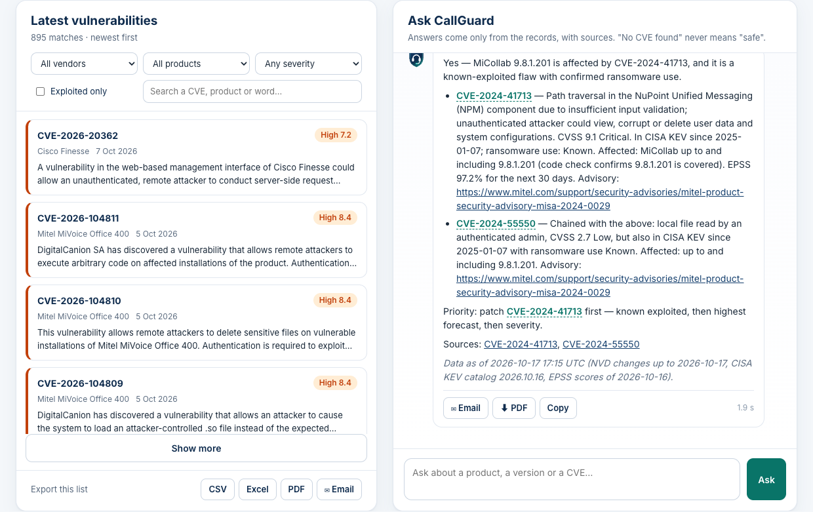
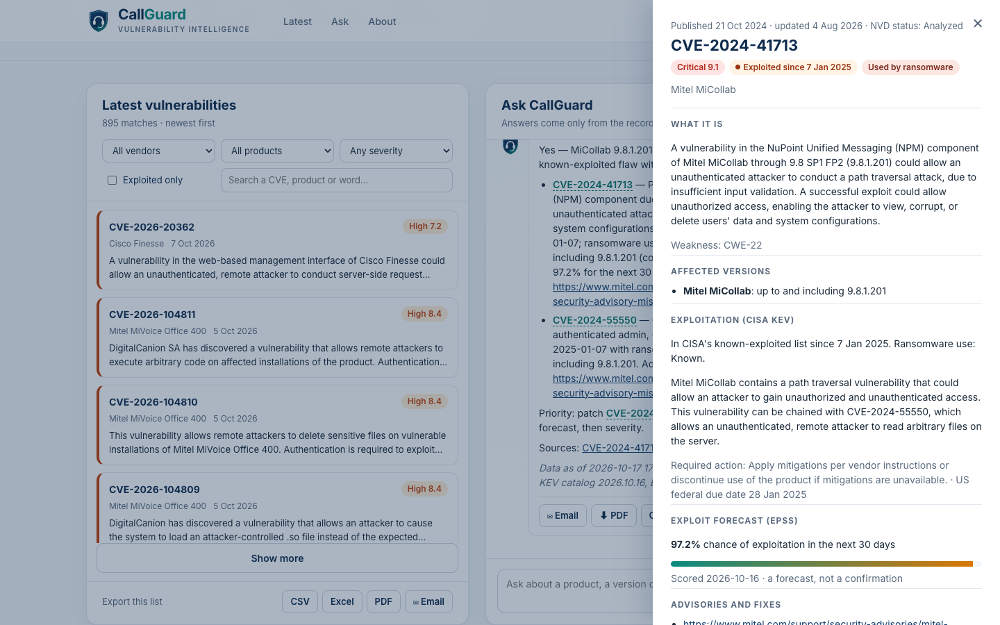
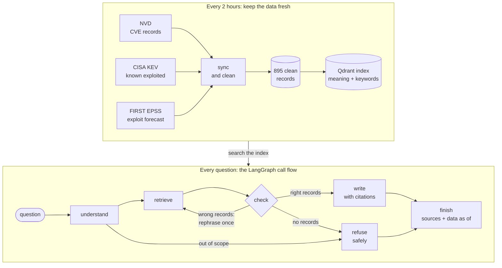

<p align="center">
  
</p>
<h1 align="center">CallGuard</h1>
<p align="center"><b>Vulnerability intelligence for contact-center and unified-communications systems</b></p>

CallGuard answers the question every contact-center support team gets after a security headline: **"Are we exposed?"** You ask in plain English, by product, version or CVE number. CallGuard answers only from public data (NVD, CISA KEV and FIRST EPSS), refreshed every 2 hours. It cites every claim and checks versions in code. When it has no matching record, it says so plainly, and that never means "safe".

Built for the GEN ACADEMY RAG course.



## What it does

- **Covers 24 contact-center and UC products:** 8 Cisco, 5 Avaya and 7 Mitel products, plus Asterisk, FreePBX, Genesys Engage/PureConnect and Verint. The list is in [`config/products.toml`](config/products.toml).
- **Answers four kinds of question:**
  - By CVE number: "What is CVE-2024-41713, and are attackers using it?"
  - By version: "We run Cisco Finesse 12.6(2)ES3. Does CVE-2026-20362 affect us?"
  - By description: "Could someone near a Mitel desk phone attack it over Bluetooth?"
  - Multi-step: "We run FreePBX. Which vulnerabilities should we patch first?"
- **Cites every claim** as [CVE-…], links each CVE's NVD page, and stamps every answer with "data as of".
- **Checks versions in code**, not with the AI. That includes vendor formats like `12.6(1)ES1` and ranges like "up to and including 9.8.1.201".
- **Ranks patches by risk, not just severity:** known exploited (CISA KEV) first, then the exploit forecast (EPSS), then severity (CVSS).
- **Refuses safely** in five cases: an unknown product, a cloud service, a product deliberately left out of scope, a question about your own systems, and no matching records. It never implies "safe".
- **Stays fresh:** it syncs NVD, KEV and EPSS every 2 hours and re-indexes only what changed.
- **Has a website** with:
  - the latest vulnerabilities, with filters and a details view
  - a chat whose answers appear as they're written
  - CSV, Excel and PDF downloads
  - email drafts for any number of recipients



## Results

The 25-question exam in [`eval/questions.toml`](eval/questions.toml) was written before the assistant was built:

| Type | Questions |
|---|---|
| By CVE number | 4 |
| By version | 5 |
| By description | 5 |
| Multi-step | 4 |
| Freshness | 2 |
| Should be refused | 5 |

RAGAS graded the answers, using a different model as judge from the one that wrote them.

| Measure | Target | Result |
|---|---|---|
| Faithfulness (RAGAS, 20 answerable questions) | 90% or more | **92%** |
| Correct refusals | 95% or more | **5 of 5**, and no false refusals |
| Response time, p95 | under 6 s | **4.6 s** (p50 2.4 s, over 75 answers) |
| Context precision / recall (RAGAS) | | 92% / 95% |
| Expected CVEs found | | 95% |
| Citations not in the records | 0 | **0** |

For details, see [`reports/evaluation.md`](reports/evaluation.md) and [`reports/failure_analysis.md`](reports/failure_analysis.md).

## How it works



1. **Collect and clean** ([`scripts/collect.py`](scripts/collect.py), [`callguard.clean`](src/callguard/clean.py)).
   - Pull every CVE that mentions each vendor from the NVD API.
   - Keep the ones whose product data matches a product in scope. If a record has no product data, its description is checked instead.
   - Add CISA KEV and FIRST EPSS. Each CVE becomes one clean record with its affected versions, severity, exploitation status and links.
2. **Index** ([`callguard.index`](src/callguard/index.py)).
   - Each CVE becomes one chunk: a short "card" with a header line (CVE, products, severity, KEV), the description, the affected versions, the weakness and CISA's notes.
   - Each card is stored two ways in a local Qdrant index: as an embedding from Qwen3-Embedding-8B, for search by meaning, and as BM25 keywords, for exact words such as CVE numbers.
3. **Understand and retrieve** ([`callguard.understand`](src/callguard/understand.py), [`callguard.retrieve`](src/callguard/retrieve.py), [`callguard.versions`](src/callguard/versions.py)).
   - Plain code reads the question for CVE numbers, products, versions and intent.
   - CVEs named in the question are opened directly.
   - Otherwise filters narrow the search, and they're relaxed step by step if nothing matches. "What first?" questions are ranked by the patch-priority rule, "newest" questions by date, and everything else by hybrid search (meaning and keyword results merged with RRF).
   - If a version is named, code marks each CVE as affected, not affected or unknown.
4. **Answer** ([`callguard.graph`](src/callguard/graph.py), [`callguard.answer`](src/callguard/answer.py)). A LangGraph flow runs these steps:
   - For open-ended questions, a quick model (Qwen3-235B) checks that the records fit, and may rephrase the search once.
   - DeepSeek-V4.1-Flash writes the answer from the records, following an 11-rule prompt.
   - Code handles the refusals it can decide on its own, adds the sources and "data as of", and flags any citation that wasn't in the records.
   - Every step is traced in LangSmith.
5. **Keep fresh** ([`callguard.sync`](src/callguard/sync.py)). Every 2 hours, CallGuard asks NVD what changed, refreshes KEV and EPSS, and updates only the changed records in the index.
6. **Website** ([`callguard.web`](src/callguard/web.py), [`web/`](web/)). FastAPI serves plain HTML, CSS and JavaScript, and streams each answer as it's written.

The decisions and the measurements behind them are in [`NOTES.md`](NOTES.md), phase by phase.

## Run it

You need:
- macOS or Linux
- [uv](https://docs.astral.sh/uv/)
- a [Nebius Token Factory](https://tokenfactory.nebius.com) API key

Two more keys are optional: a [LangSmith](https://smith.langchain.com) key for tracing, and an [NVD API key](https://nvd.nist.gov/developers/request-an-api-key) for faster downloads.

```bash
git clone https://github.com/senthilkumarpackiyam/callguard.git
cd callguard
uv sync
cp .env.example .env              # put your keys in .env (no LangSmith key? set LANGSMITH_TRACING=false)
uv run scripts/check_setup.py     # checks Python, .env, the four data sources, Nebius and LangSmith
uv run scripts/build_index.py     # embeds the records and builds the search index (about 2 minutes)
uv run scripts/serve.py           # then open http://localhost:8000
```

The repository includes the clean records (`data/processed/`), so you can build the index straight away. To refresh the data:

```bash
uv run scripts/sync.py               # fetch what changed since the data was collected
uv run scripts/collect.py            # or download everything again (about 3 minutes)
uv run scripts/schedule_sync.py on   # macOS: sync every 2 hours (on Linux, use cron to run sync.py)
```

To ask from the command line (it also prints a link to the LangSmith trace):

```bash
uv run scripts/ask.py "Is MiCollab 9.8.1.201 affected by CVE-2024-41713?"
```

### Tests and evaluation

```bash
uv run pytest                     # 37 tests: versions, sync and cleaning, patch order, the website's data

# With the website running and Chrome installed, use the site like a visitor would (12 checks)
uv run --no-project --with playwright python scripts/check_website.py

# Sit the exam again and grade it (RAGAS runs in its own environment)
uv run scripts/run_exam.py --setup more-records
uv run --no-project --with "ragas==0.4.3" --with "langchain-community<0.4" --with "langchain-openai<1" \
    --with python-dotenv python scripts/score_ragas.py eval/results/more-records.jsonl
uv run scripts/report_eval.py
```

## What's where

| Path | What it holds |
|---|---|
| `config/products.toml` | The products in scope, every name each one goes by, and their vendors |
| `src/callguard/` | The library: sources, cleaning, index, understanding, versions, retrieval, answers, the call flow, sync, website and downloads |
| `scripts/` | Everything you run: collect, index, search, ask, sync, serve, and the exam and grading |
| `data/processed/` | The clean records, the "data as of" times and the sync log |
| `eval/` | The 25-question exam, with every answer and grade |
| `reports/` | Reports on the data, retrieval, model choice and call flow, plus the evaluation and failure analysis |
| `notebooks/` | One CVE followed through all the sources |
| `web/` | The website: page, styles, script and brand |
| `tests/` | Automated tests |
| `NOTES.md`, `ROADMAP.md` | The build log and the learning roadmap |

## Limitations

- **"No CVE found" never means safe.** CallGuard only knows published CVEs for the products it covers.
- **A CVE can occasionally be missed.** If a record never names its vendor, CallGuard may not find it until it changes and the sync picks it up.
- **Cloud services rarely get CVEs.** This applies to Amazon Connect, NICE CXone, Five9, Genesys Cloud CX and Twilio Flex, and CallGuard says so instead of guessing.
- **Version checks are only as good as the published version data.** When versions appear only in a description, CallGuard reports the check as unknown.
- **It's a single-user demo:** one question at a time, no sign-in, and meant to run on your own computer.

## Data sources and credits

- **NVD** (NIST): CVE records. *This product uses the NVD API but is not endorsed or certified by the NVD.*
- **CISA**: the Known Exploited Vulnerabilities catalog.
- **FIRST**: the Exploit Prediction Scoring System (EPSS).
- The AI models run on Nebius Token Factory. The website uses [marked](https://marked.js.org) and [DOMPurify](https://github.com/cure53/DOMPurify).
