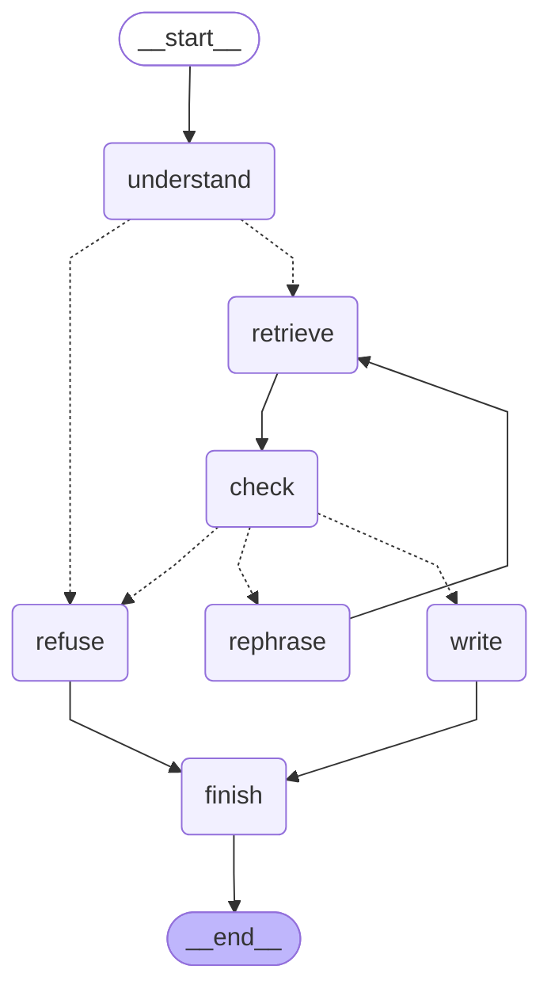

# The call flow on all 25 exam questions

Every question ran through the LangGraph flow three times: checking every search (the check can rephrase the search once), checking only open-ended questions that name no product, vendor or CVE (the default), and with no check. Each run is traced in LangSmith, project `callguard`.

| Flow | Expected CVEs found | Expected CVEs cited | Refusals worded safely | Citations not in the records | Check said 'doesn't fit' | Rephrased | Average time | p95 time |
|---|---|---|---|---|---|---|---|---|
| check every search | 90% | 90% | 5/5 | 0 | 3 | 2 | 4.2 s | 8.2 s |
| check open questions only (default) | 90% | 90% | 5/5 | 0 | 1 | 0 | 2.8 s | 4.0 s |
| no check | 90% | 90% | 5/5 | 0 | 1 | 0 | 2.8 s | 4.4 s |

## Question by question (default flow)

| Question | Route | Check | Rephrased | Result | Expected CVEs found | Time |
|---|---|---|---|---|---|---|
| E1: What is CVE-2024-41713, and are attackers using it? | lookup | fits |  | answer | 1/1 | 3.03 s |
| E2: Tell me about CVE-2026-20362. How serious is it? | lookup | fits |  | answer | 1/1 | 2.98 s |
| E3: What does CVE-2025-64328 affect, and is it being exploited? | lookup | fits |  | answer | 1/1 | 3.49 s |
| E4: Explain CVE-2022-29499. | lookup | fits |  | answer | 1/1 | 2.06 s |
| V1: We run Cisco Finesse 12.6(2)ES3. Does CVE-2026-20362 affect us? | lookup | fits |  | answer | 1/1 | 3.59 s |
| V2: Is MiCollab 9.8.1.201 affected by CVE-2024-41713? | lookup | fits |  | answer | 1/1 | 2.27 s |
| V3: We upgraded MiCollab to 9.8.2.0. Are we still affected by CVE-2024-41713? | lookup | fits |  | answer | 2/2 | 3.7 s |
| V4: We run Asterisk 18.9.0. Are we exposed to any critical vulnerabilities? | search | fits |  | answer | 2/2 | 3.92 s |
| V5: Our CUCM is on 14SU2. Which known-exploited vulnerabilities affect it? | search | fits |  | answer | 2/2 | 2.51 s |
| S1: Can an attacker trick Cisco Finesse into sending requests to internal systems? | search | fits |  | answer | 4/5 | 4.73 s |
| S2: Is there a way to read or change files on a MiCollab server without logging in? | search | fits |  | answer | 4/7 | 3.57 s |
| S3: Which workforce-management or workload-distribution tools have SQL injection flaws? | search | fits |  | answer | 2/2 | 2.88 s |
| S4: Could someone near a Mitel desk phone attack it over Bluetooth? | search | fits |  | answer | 1/1 | 1.9 s |
| S5: Can a FreePBX user who only has User Control Panel access run commands on the server? | search | fits |  | answer | 1/1 | 2.84 s |
| M1: Which Mitel vulnerabilities have been used in ransomware attacks? | search | fits |  | answer | 4/4 | 3.43 s |
| M2: Are any exploited Cisco UC vulnerabilities linked to ransomware? | search | fits |  | answer | 2/2 | 2.78 s |
| M3: We run FreePBX. Which vulnerabilities should we patch first? | priority | fits |  | answer | 3/3 | 3.67 s |
| M4: CVE-2024-55550 is only rated Low. Can we leave it until last? | lookup | fits |  | answer | 2/2 | 2.22 s |
| F1: What new vulnerabilities were published for our products in the past 7 days? | newest | fits |  | answer | - | 3.94 s |
| F2: What's the most recent Cisco contact-center vulnerability, and when was it published? | newest | fits |  | answer | - | 2.33 s |
| R1: Are there any vulnerabilities in Avaya CloudQueue Pro 4.2? | search | fits |  | answer | - | 1.59 s |
| R2: Is Amazon Connect affected by any critical vulnerabilities? | cloud | doesn't fit |  | refusal (cloud) | - | 0.08 s |
| R3: What vulnerabilities affect Cisco Emergency Responder? | out of scope | - |  | refusal (out of scope) | - | 0.0 s |
| R4: Have we patched CVE-2024-41713 on our MiCollab servers? | lookup | fits |  | answer | - | 2.68 s |
| R5: Are there known vulnerabilities in Avaya Aura Communication Manager 10.2? | search | fits |  | answer | - | 3.95 s |
